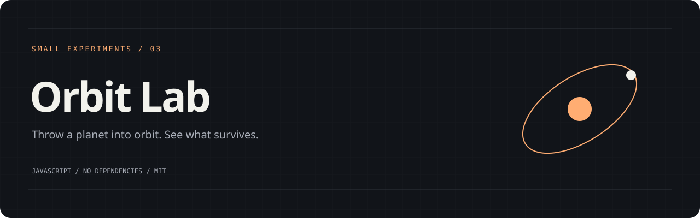
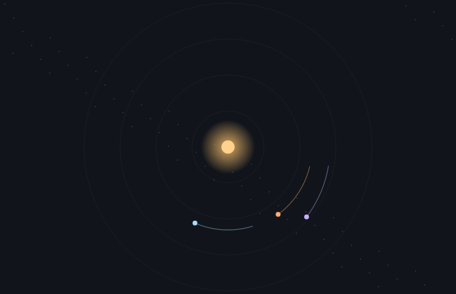

# Orbit Lab

An orbital sandbox with a fixed central star. Drag on the canvas to choose a starting position and velocity, then see whether the planet settles, dives or escapes.



## Run it

From this folder:

```sh
python3 -m http.server 8000
```

Open [localhost:8000](http://localhost:8000). On Windows, use `py -m http.server 8000` if Python is installed through the launcher. Serve one project per port. No install step, CDN or API key.

A longer drag creates a faster launch. Add a random orbit creates a circular orbit using the current gravity. Pause, adjust gravity or change the time speed. Twelve planets is the cap.

## Under the hood

Velocity Verlet integration advances the simulation at a fixed 1/120-second step. Gravity uses a softened inverse-square field. Trails remember the last 900 simulation positions. Each planet responds only to the fixed star.

`src/core.mjs` holds the testable logic. `src/app.mjs` connects it to the page. Styles and assets live in this repository; the app makes no external requests. A local server is required because the scripts use ES modules.

## Check it

Node.js 20 or newer is only needed for development checks:

```sh
npm run check
npm test
```

The same commands run on pushes and pull requests through GitHub Actions.

## A few limits

Planets disappear inside the star or beyond 1,600 canvas units. Time does not advance while the tab is hidden. Reduced-motion preferences start the simulation paused. The canvas supports pointer input; the random-orbit button is the keyboard alternative.

## A next experiment

Add energy readouts or compare Verlet with Euler integration.

## License

[MIT](LICENSE)
